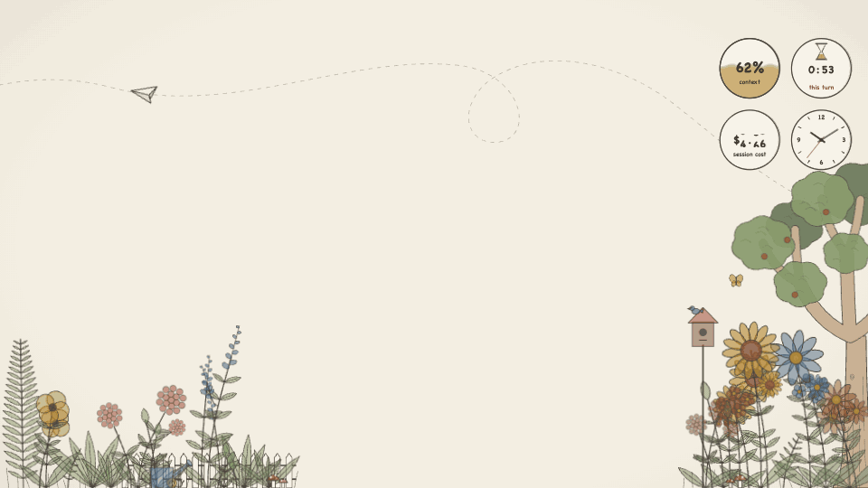
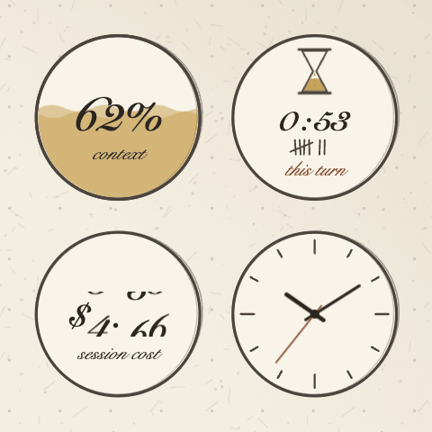
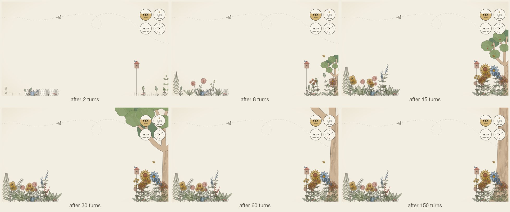

# Paper Dials

A light paper theme for the Claude desktop app (the Code tab). Cream paper behind the chat, four hand-drawn dials in the top right that show real numbers from your session, and a little garden along the bottom that grows the longer the session runs.



## The dials



| Dial | What it shows |
| --- | --- |
| context | a wash that rises as the context window fills, with little waves |
| turn | an hourglass and the turn's time counting up while Claude works; between turns, how long the last turn took and a tally mark per tool call |
| session cost | dollars so far, digits roll to the new number (shows rate limits instead if your plan has them) |
| clock | local time, hands turn |

## The garden

It grows with the session, one step per turn.



- A session starts with two seedlings on each side. They grow up, their buds open, and new seedlings keep coming up among them. Nine kinds of flower (daisies, tulips, poppies, sunflowers, spikes, bells, globes and more), plus ferns and leafy clumps.
- Every session grows its own plants from its own seed, so no two gardens match.
- A tree stands at the right edge of the page. It grows far more slowly than the flowers and never quite stops: a sapling, then a young tree, then a crown that fills the corner, and in a very long session just a big trunk with bark, because the crown has grown out of view.
- There is a picket fence, a watering can, a birdhouse with a bird, mushrooms, a snail and a butterfly.
- Every 40 seconds a fox steps in from the bottom right, looks around and steps back out.
- A paper plane keeps flying across the top.

The picture is only redrawn when a turn starts and when it ends, so nothing flickers while Claude works.

## Install

In a terminal session, at the prompt:

```
/plugin install paper-dials --marketplace cktang88/claude-paper-dials
```

Answer `y` to add the marketplace, then pick a scope (user is fine).

From a shell:

```
claude plugin install paper-dials --marketplace cktang88/claude-paper-dials
```

In the desktop app, where `/plugin` does not run: click + next to the prompt box, then Plugins, Add marketplace with `cktang88/claude-paper-dials`, then Add plugin.

`/paper-dials` turns the theme on again, `/paper-dials off` clears it for the session.

Only tried on the macOS desktop app. The lettering uses Chalkboard SE and falls back to other hand-printed fonts.

## If you want to make your own animated backdrop

This took a while to figure out, so here it is. Seen on engine 2.1.325, it may change.

The app only keeps the motion in a mod's backdrop picture if the SVG passes a strict check. If it fails, you get no error. The picture just shows up frozen. Things that fail it:

- any `@media` rule other than `prefers-reduced-motion` (so no layout changes by window shape)
- any function outside a short list. Colors, math, `var()`, transforms, `cubic-bezier()`, `steps()` and the filter functions are fine. `path()` is not, so no `offset-path`
- `url(...)` that is not `url(#some-id)`, and anything with `data:`
- elements like `image` or `foreignObject`
- viewport units, backslashes, `on...` attributes, an `href` that is not `#some-id`
- SVG that is not well-formed XML

Also good to know:

- The picture's source can be at most 131,072 characters. Over that, the app shows nothing at all.
- A redraw restarts every animation, and shows as a quick flash of the whole picture. Redraw rarely, and give each animation a negative `animation-delay` for how far along it already is so it carries on smoothly (see `--at` and `--turn` in `hooks/scene.ts`).
- The backdrop runs under the app's left sidebar, so anything at the left edge is hidden while the sidebar is open.
- To pin things to different corners, use a root `<svg>` with no `viewBox` and put nested `<svg>`s in it, each with its own `viewBox` and `preserveAspectRatio`.
- The mod reloads when the next turn starts, not when you save.
- The backdrop hook must answer right away (not `async`).

## Credits

The idea of a garden grown from a seed comes from Kevin Raymond's [florilegium](https://github.com/kevinraymond/florilegium), which draws procedural flowers in LaTeX page margins. None of its code is used here; these plants are drawn from scratch in a simpler pencil style.

`hooks/make-colors.js` is the color helper that ships with Claude Code's plugin-authoring skill, copied in unchanged.
