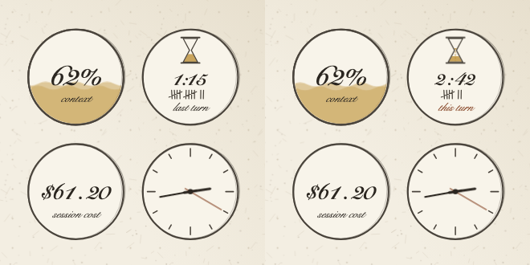

# Paper Dials

A light paper theme for the Claude desktop app (the Code tab). Warm paper behind the chat, and four pencil-sketched dials in the top right that move and show real numbers from your session.



| Dial | What it shows |
| --- | --- |
| context | an ink wash that rises as the context window fills, with little waves |
| turn | an hourglass that runs while Claude works, the turn's time counting up, and one tally mark per tool call |
| session cost | dollars so far, digits roll to the new number (shows rate limits instead if your plan has them) |
| clock | local time, hands turn |

There is also a small status row above the prompt with the same numbers as text.

## Install

In a terminal session, at the prompt:

```
/plugin install paper-dials --marketplace cktang88/claude-paper-dials
```

Answer `y` to add the marketplace, then pick a scope (user is fine).

From a shell:

```
claude plugin install paper-dials --marketplace cktang88/claude-paper-dials
```

In the desktop app, where `/plugin` does not run: click + next to the prompt box, then Plugins, Add marketplace with `cktang88/claude-paper-dials`, then Add plugin.

`/paper-dials` turns the theme on again, `/paper-dials off` clears it for the session.

Only tried on the macOS desktop app. The lettering uses Snell Roundhand and falls back to other cursive fonts.

## If you want to make your own animated backdrop

This took a while to figure out, so here it is. Seen on engine 2.1.325, it may change.

The app only keeps the motion in a mod's backdrop picture if the SVG passes a strict check. If it fails, you get no error. The picture just shows up frozen. Things that fail it:

- any `@media` rule other than `prefers-reduced-motion` (so no layout changes by window shape)
- any function outside a short list. Colors, math, `var()`, transforms, `cubic-bezier()`, `steps()` and the filter functions are fine. `path()` is not, so no `offset-path`
- `url(...)` that is not `url(#some-id)`, and anything with `data:`
- elements like `image` or `foreignObject`
- viewport units, backslashes, `on...` attributes, an `href` that is not `#some-id`
- SVG that is not well-formed XML

Also good to know:

- A redraw restarts every animation. Give each one a negative `animation-delay` for how far along it already is and it carries on smoothly (see `--at` and `--turn` in `hooks/scene.ts`).
- The mod reloads when the next turn starts, not when you save.
- The backdrop hook must answer right away (not `async`).

`hooks/make-colors.js` is the color helper that ships with Claude Code's plugin-authoring skill, copied in unchanged.
